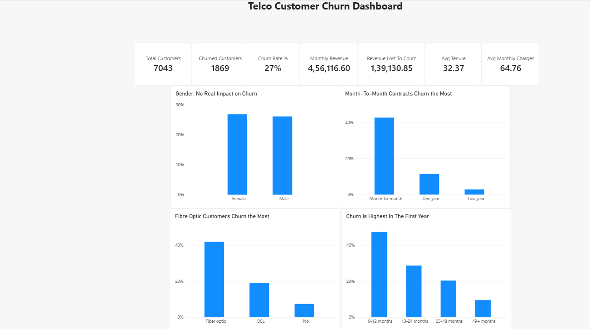

# Telco Customer Churn Dashboard

An interactive Power BI dashboard analyzing why telecom customers leave and which groups are most at risk.

## Business Question
Which customers are most likely to churn, and what can the company do about it?

## Dataset
Telco Customer Churn dataset (Kaggle): 7,043 customers, 21 columns.

## Tools
Power BI, Power Query, DAX

## Key Findings
- **Overall churn rate is 26.5%** (1,869 of 7,043 customers), costing about $139K in monthly revenue.
- **Contract type:** Month-to-month customers churn ~42.7%, about 15x more than two-year customers (~2.8%).
- **Internet service:** Fiber optic customers churn ~41.9%, more than double DSL (~19.0%).
- **Tenure:** Customers in their first year churn ~47.7%, falling to ~9.5% after 4 years.
- **Gender:** No meaningful difference, so it is not a churn driver.

## Recommendations
- Offer discounts to move month-to-month customers onto 1-2 year contracts.
- Run onboarding and support programs during the first 12 months.
- Investigate pricing and service quality for fiber optic.

## Files
- `dashboard.png`: dashboard screenshot
- The `.pbix` file: open with Power BI Desktop
- The CSV file: raw data
